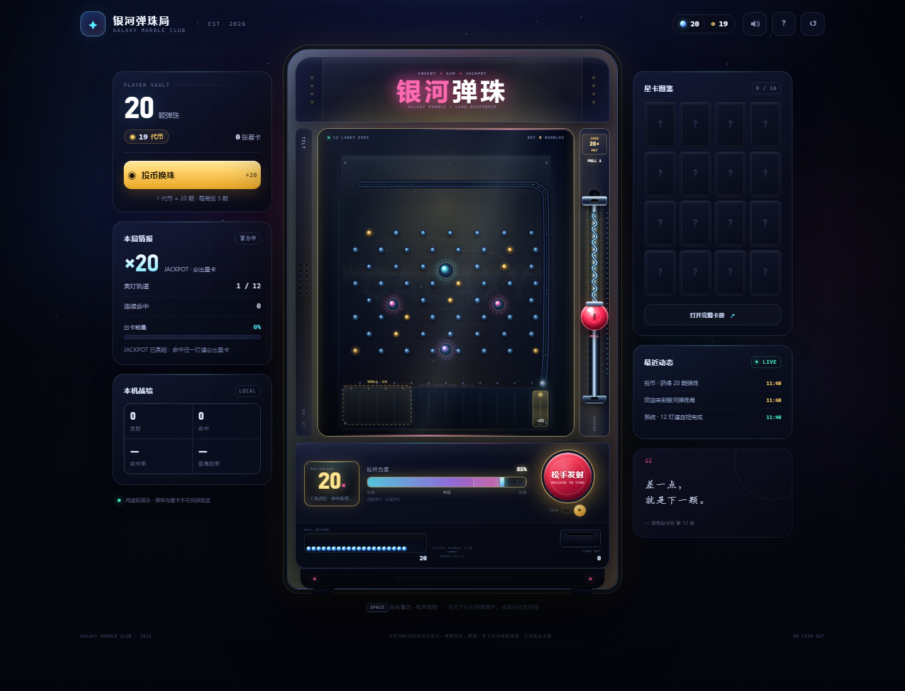

# 银河弹珠局 · Galaxy Marble Club

一台放进浏览器里的商场弹珠机：投币换珠、随机倍率、下拉弹簧杆控力、12 灯道落袋、出弹珠，再攒能量吐星卡。纯 Canvas + CSS，无外部图片、字体或依赖。

> A browser-sized mall marble machine: insert a coin, lock a random multiplier, pull the spring plunger, land the steel ball in a lit lane, and collect star cards. One folder, no dependencies, no server.



## 快速开始

1. 下载本仓库。
2. 双击 `index.html`（或 `start.bat`）。
3. 或者打开在线版：<https://dsjsunu.github.io/galaxy-marble/>

不需要安装依赖，也不需要联网。建议用 Chrome / Edge 打开。

## 玩法

1. **投币换珠**：1 枚代币换 20 颗弹珠；每发射一次大钢珠消耗 5 颗。
2. **随机倍率**：每局自动抽取 `2× / 4× / 6× / 8× / 10× / 20×`，机器点亮对应数量的底部灯道。
3. **控力度**：按住红色发射键，或向下拉动右侧弹簧杆再松手。轻推走右路，拉满冲左路；蓄力时弹簧会拉长、回弹，底部出现“预测落点”虚线框。
4. **命中灯道**：大钢珠落入亮灯轨道，赢得「5 × 本轮倍率」颗弹珠。比如 `6×` 命中 = 30 颗。
5. **出卡**：每次发射积累出卡能量，命中加得更多；能量满格时，机器从右下方卡口吐出一张星卡。
6. **特殊规则**：`20× JACKPOT` 命中必出星卡；未中灯道返还 1 颗安慰珠；重复星卡自动折算成弹珠。

## 操作

- **鼠标 / 触屏**：按住发射按钮蓄力，松开发射；也可以直接向下拖动右侧的红色弹簧杆。
- **键盘**：按住 `Space` 蓄力，松开发射；弹簧杆获得焦点时也支持 `Space` / `Enter`。
- 右上角 `?` 查看规则，`↺` 清空存档。
- 桌面端左侧是本局数据、右侧是卡册预览与实时记录；窄屏自动收纳成底部快捷栏。

## 视觉与反馈

- 每局锁定的倍率会改变整台机器的环境光：2× 薄荷、6× 紫、10× 橙、20× 金色。
- 弹簧杆随力度真实拉伸，松手回弹并带有弹簧音效。
- 中奖时有灯道光环、粒子、屏幕轻闪与机台震动；8× 以上进入高温灯光状态。
- 星卡揭示框跟随卡面主色变化，SSR 附带全息呼吸光。

## 存档

代币、弹珠、星卡图鉴、发射统计和音效设置保存在浏览器 `localStorage`，关掉页面再打开会继续。清空浏览器数据会重置到初始状态。

## 项目结构

```text
galaxy-marble/
├─ index.html     页面结构
├─ styles.css     街机外观与响应式布局
├─ game.js        弹珠物理 / 倍率 / 奖励 / 卡册 / 音效
├─ preview.png    预览截图
├─ start.bat      Windows 双击启动
└─ README.md
```

## 说明

- 本作是怀旧街机玩法演示，所有代币、弹珠、星卡均为虚拟道具，**不可兑换现金**。
- 页面内所有图形均由 Canvas / CSS 绘制，无外部图片或字体依赖。
- 玩法结构参考了商场 12 光眼弹珠机的公开玩法报道。
- 代码以 [MIT](LICENSE) 许可发布。

## English

A single-page arcade marble machine: coin in, random multiplier, spring plunger with power control, twelve lit lanes, star-card dispenser, synthesized sound. Everything is drawn with Canvas/CSS and stored locally; no assets, no backend. MIT licensed.

---

差一点，就是下一颗。
