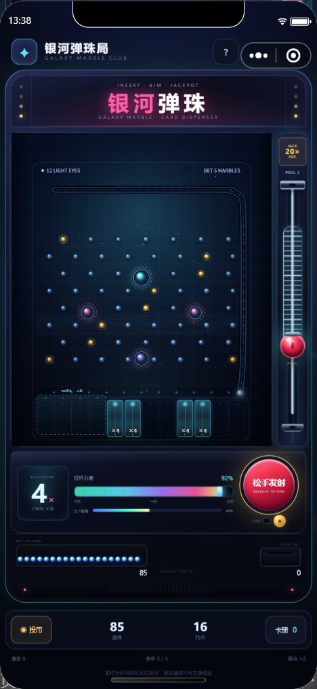

# 银河弹珠局 · 微信小程序版

[银河弹珠局](../README.md) 的小程序版本。把网页版里的「投币、随机倍率、12 灯道、下拉弹簧杆、出珠、出卡」按手机竖屏重新做了一遍。



## 打开

1. 打开微信开发者工具 → **导入项目** → 选择本目录（`galaxy-marble/miniprogram`）。
2. `project.config.json` 里的 AppID 是 `touristappid`（游客模式），可以直接编译预览；正式发布时换成你自己的小程序 AppID。
3. 编译后点「预览」生成二维码，用有权限的微信扫码体验。
4. 上传代码后，由管理员在小程序后台提交审核、发布。

基础库 `3.17.5`，默认 WebView 渲染，不需要 npm、不需要云开发、没有外部图片或字体。

## 已实现玩法

- **投币**：1 枚代币 = 20 颗弹珠；每局消耗 5 颗
- **随机倍率**：`2× / 4× / 6× / 8× / 10× / 20×`，点亮对应数量的底部灯道
- **弹簧杆**：在机台右侧向下拖动，弹簧拉长、力度条上涨；松手回弹并发射钢珠
- **落点控制**：轻推走右路，拉满冲左路，底部虚线显示预测落点区
- **奖励**：落入亮灯轨道赢得「5 × 倍率」颗弹珠；20× 命中必出星卡；未中返 1 颗安慰珠
- **出卡**：命中累积出卡能量，能量满格从右下卡口吐出星卡；重复卡折算弹珠
- **卡册**：16 张星卡，N / R / SR / SSR 稀有度
- **视觉反馈**：倍率变色机台、灯道发光、粒子、钢珠轨迹、弹簧回弹、触感震动
- **本地存档**：代币、弹珠、图鉴、统计保存在小程序本地存储
- **分享**：已配置 `onShareAppMessage`

## 结构

```text
miniprogram/
├─ app.js / app.json / app.wxss
├─ project.config.json
├─ pages/game/game.js    弹珠物理、倍率、奖励、卡册、音效
├─ pages/game/game.wxml
├─ pages/game/game.wxss
└─ preview.png
```

## 注意

- 这是小程序版本，需要微信开发者工具；网页版在仓库根目录，双击 `index.html` 就能玩。
- 所有代币、弹珠、星卡均为虚拟道具，不可兑换现金。
